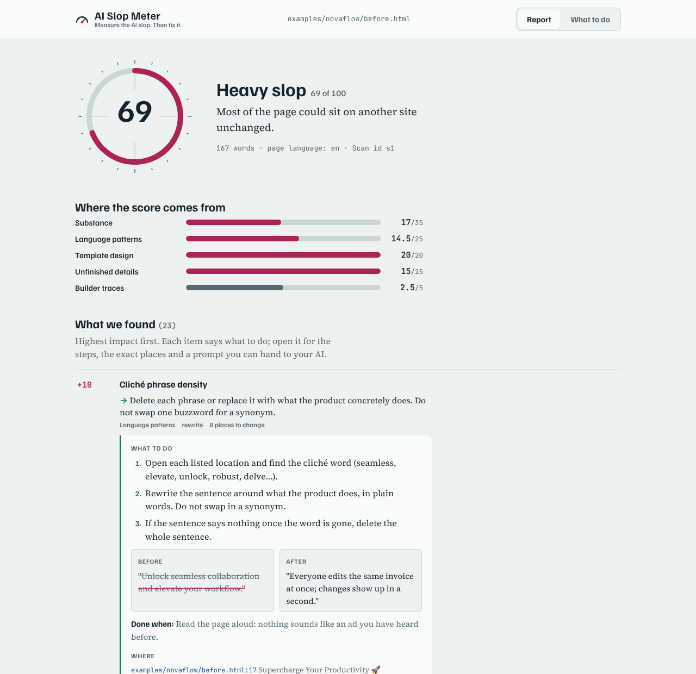
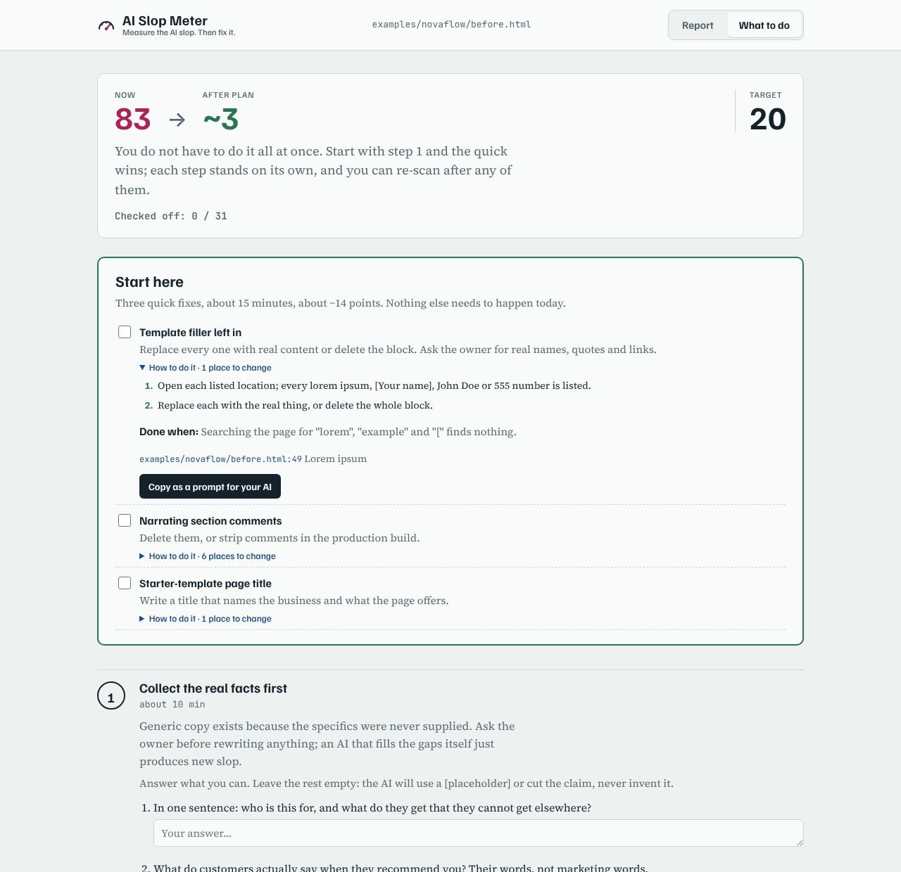
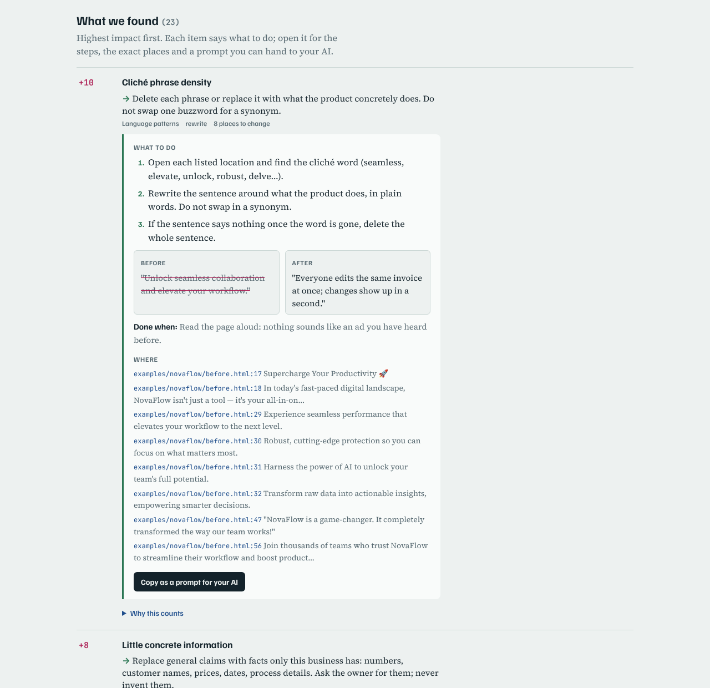

# AI Slop Meter

[Türkçe](README.tr.md) · **English** · [Website](https://aislopmeter.netlify.app)

[](https://www.npmjs.com/package/aislopmeter)
[](https://github.com/omergocmen/aislopmeter/actions/workflows/ci.yml)
[](LICENSE)

**Measure the AI slop on any website. Then fix it.**

AI Slop Meter scores a website, a local app or a web project for *slop*: generic copy, the default AI-builder look, and unfinished details.

- It shows the evidence behind every point, down to the file and line.
- It tells you what to do about each finding, with steps and a prompt you can hand to your AI.
- Your own AI (Claude, Cursor, Gemini CLI and others) can then carry out the plan in your code.

It runs on your machine as an **MCP server**, a **CLI** and a **bookmarklet**. No API keys, no account, nothing sent anywhere except the requests to the site you asked it to scan.

## Quick start

1. **Try it once**, nothing to install: `npx -y aislopmeter https://your-site.com --open`
2. **Add it to your AI** (Claude Code, once for all projects): `claude mcp add --scope user aislopmeter -- npx -y aislopmeter mcp`
3. **Ask:** "Rescue my site from slop. Open the report when you're done." Answer the questions it asks; it fixes, re-scans and shows before and after.

The **[usage guide](docs/USAGE.md)** walks through it in order, with every command, the MCP tools, ready-made recipes (Lovable/Vite apps, Next.js, CI) and troubleshooting.

## Install in one click

[](https://cursor.com/install-mcp?name=aislopmeter&config=eyJjb21tYW5kIjoibnB4IiwiYXJncyI6WyIteSIsImFpc2xvcG1ldGVyIiwibWNwIl19)
[](https://insiders.vscode.dev/redirect?url=vscode%3Amcp%2Finstall%3F%7B%22name%22%3A%22aislopmeter%22%2C%22command%22%3A%22npx%22%2C%22args%22%3A%5B%22-y%22%2C%22aislopmeter%22%2C%22mcp%22%5D%7D)
[](https://github.com/omergocmen/aislopmeter/releases/latest/download/aislopmeter.mcpb)

| Where | How |
|---|---|
| **Claude Code** | `claude mcp add --scope user aislopmeter -- npx -y aislopmeter mcp`<br>or as a plugin with a rescue skill: `/plugin marketplace add omergocmen/aislopmeter`, then `/plugin install aislopmeter@aislopmeter` |
| **Claude Desktop** | Download [aislopmeter.mcpb](https://github.com/omergocmen/aislopmeter/releases/latest/download/aislopmeter.mcpb) and double-click it. No Node.js needed. |
| **Cursor** | The button above, or add the block below to `~/.cursor/mcp.json` |
| **VS Code** | The button above, or `"servers": { "aislopmeter": { "type": "stdio", "command": "npx", "args": ["-y", "aislopmeter", "mcp"] } }` in `.vscode/mcp.json` |
| **Gemini CLI, Windsurf, others** | Add the block below to the tool's MCP settings (`~/.gemini/settings.json` for Gemini CLI) |
| **No install** | `npx -y aislopmeter https://your-site.com --open`, or the [bookmarklet](#in-the-browser-bookmarklet) |

```json
{
  "mcpServers": {
    "aislopmeter": { "command": "npx", "args": ["-y", "aislopmeter", "mcp"] }
  }
}
```

You need [Node.js](https://nodejs.org) 20 or newer, except for the Claude Desktop extension. `--scope user` in Claude Code installs it once for all projects; leave it out to add it to one folder, or use `--scope project` to share it through `.mcp.json`.

Then ask your AI: **"Scan https://my-site.com for AI slop and show me what to fix."**

| Before: 83 / 100, pure slop | After: 1 / 100, clean |
|---|---|
|  |  |

Both pages are in [`examples/novaflow`](examples/novaflow). The "after" page was rewritten using the owner's answers to the rescue plan's questions ([FACTS.md](examples/novaflow/FACTS.md)). The product and its numbers are fictional.

## What it does

1. **Scans** a whole website, a `localhost` app, a project folder (Next.js, Vite/React, Astro, Vue, Svelte, plain HTML, Markdown content…) or a single `.html` file. For a website it finds the pages through `sitemap.xml` and internal links (respecting `robots.txt`), scans up to 30 by default (`--pages all` for up to 200) and gives **every page its own score and to-do list**. A problem that repeats across pages is shown once, with the list of pages it is on.
2. **Reads what the page really looks like.** It reads the site's own stylesheets and scripts, and when Chrome or Edge is installed it opens the page and measures it: computed colours and real contrast, the fonts actually rendered, how much is centred, whether cards are truly identical. Without a browser it still works from the HTML and CSS.
3. **Scores** five areas with more than 60 research-based checks ([criteria and sources](docs/CRITERIA.md)):
   - **Substance:** concrete facts, claims you can check, real proof, a portfolio with actual work in it
   - **Language patterns:** clichés, headline formulas, "not just X, but Y", stock microcopy
   - **Template design:** purple gradients, glow, emoji and stock icons, the standard landing-page and portfolio templates, Tailwind's default colours, typing effects
   - **Unfinished details:** lorem ipsum, `href="#"`, "Vite + React + TS", chatbot leftovers, pages that are empty without JavaScript
   - **Builder traces:** Lovable, Bolt, v0, Replit, Base44 (information only)
4. **Tells you what to do about every finding:** a one-line fix, numbered steps, the exact `file:line` places and this site's own sentences, a before/after example, a "done when" check, and a **Copy as a prompt for your AI** button.
5. **Plans the rescue** around your site: questions for the owner that fit the kind of site (so the AI never invents facts), then clean-up, copy, design and trust, each with an estimated score.
6. **Shows it** in a visual report with **Report**, **What to do** and, for sites, **Pages** screens, and **re-measures** after each change with a before/after table.

| Report | What to do |
|---|---|
|  |  |

Every finding opens to the same "what to do" box:



## Use it with your AI

> Scan my project for AI slop and show me what to fix.
> Rescue https://my-site.com from slop. Open the report when you're done.
> Sitemi slop'tan kurtar, bitince raporu tarayıcımda aç.

The **`rescue` prompt** runs the whole loop. In Claude Code it is `/mcp__aislopmeter__rescue`. The AI will:

1. ask once whether to open the report in your browser when it finishes, so you can walk away;
2. scan the target and summarise the three findings (and, for a site, the three pages) that matter most;
3. build the plan and ask you the owner questions in one message;
4. apply the plan phase by phase, editing the exact `file:line` places in a project, or handing you rewritten copy and a design spec for a live URL;
5. re-scan after each phase until the target score (default 20);
6. write the visual report, open it if you agreed, and summarise before/after.

Prefer small steps? The **`fix` prompt** (`/mcp__aislopmeter__fix`) fixes only the most important problem, re-scans, shows what changed and offers the next one.

| Tool | What it does |
|---|---|
| `slop_scan` | Scan a website (crawls up to `pages`, default 30, max 200), a `localhost` app, a folder or an `.html` file. Writes the visual report; `open_report` opens it. Re-scans compare automatically. |
| `slop_scan_html` | Scan pasted or generated HTML. |
| `slop_rescue_plan` | Turn a scan into a phased, site-specific plan, with `keep` and `target_score`. |
| `slop_page` | The full report for one page of a site scan. |
| `slop_fix` | Step-by-step instructions for one finding, optionally on one `page`. |
| `slop_report` | Write or open the visual report. |
| `slop_compare` | Before/after for two scan ids. |
| `slop_guide` | The guides: `criteria`, `playbook`, `copy`, `design`, `interview` (also MCP resources at `aislopmeter://guide/...`). |

## Local apps (localhost, project folders)

AI Slop Meter runs on your computer, so it can check an app that is not online yet. There are three ways, and they work well together.

**1. The running dev server.** Start your app (`npm run dev`), then scan its address. `localhost` is opened over http and crawled like a live site.
```bash
npx -y aislopmeter localhost:3000 --open            # whole app, up to 30 pages
npx -y aislopmeter localhost:5173/pricing --pages 1  # one page
```
Vite, Create React App and other single-page apps send an empty `<div id="root">` first; AI Slop Meter renders them with your Chrome or Edge, so the score is about what you actually see. They also get the `client-shell` finding: search engines see the same empty page unless you prerender.

**2. The project folder.** Findings come with `file:line` in your source code. This is what your AI edits.
```bash
cd my-app
npx -y aislopmeter . --plan
```

**3. The built site.** For static sites, scan the files you will actually deploy.
```bash
npm run build
npx -y aislopmeter ./dist --open
```

**With your AI:**

> My app is running at localhost:3000 and the code is in this folder. Scan both for AI slop, fix it in the code, and re-scan localhost after each step.

Online checkers cannot reach `localhost`; this one can, because it runs on your machine. Nothing is uploaded.

## In the browser (bookmarklet)

Scan the page you are looking at, with nothing installed. Create a bookmark and paste this as its address:

```text
javascript:(()=>{const s=document.createElement('script');s.src='https://cdn.jsdelivr.net/npm/aislopmeter@0/dist/aislopmeter.browser.js';s.onload=()=>AISlopMeter.overlay();document.head.appendChild(s)})()
```

Click it on any page: a panel shows the score, the top findings and a copy-for-your-AI button for each. It checks one page at a time; for a whole site and `file:line`, use the CLI or MCP. Some sites block outside scripts (Content-Security-Policy); there the bookmarklet cannot run.

## Command line

```bash
npx -y aislopmeter https://example.com                # whole site, up to 30 pages
npx -y aislopmeter https://example.com --pages all    # up to 200 pages
npx -y aislopmeter https://example.com --pages 1      # only this page
npx -y aislopmeter ./my-app --plan --lang tr          # project folder, plus the rescue plan in Turkish
npx -y aislopmeter ./my-app --open                    # write the visual report and open it
npx -y aislopmeter ./my-app --render never            # HTML and CSS only, no browser
npx -y aislopmeter ./my-app --json                    # raw result
```

Reports are written to `~/.aislopmeter/reports/` (`AISLOPMETER_REPORT_DIR` changes that).

**Browser use.** With `--render auto` (the default) and Chrome, Edge or Chromium installed, pages are also measured in the browser through `playwright-core`, which downloads nothing. Set `AISLOPMETER_CHROME` to a browser path if it is not found, or `AISLOPMETER_BROWSER=off` to never start one.

Folder scans skip `node_modules`, hidden folders and the primitives in `components/ui`. At the top of the scanned folder they also skip `dist`, `build`, `out`, `test`, `docs`, `examples` and repo documents such as README and CHANGELOG. Point AI Slop Meter at one of these directly to scan it, or use `--ignore path1,path2` to leave out more.

## Badge and GitHub Action

Show your score in your README:

```bash
npx -y aislopmeter . --badge aislopmeter.svg
```

```markdown

```

Check every pull request, with the report in the job summary:

```yaml
- uses: actions/checkout@v4
- uses: omergocmen/aislopmeter@v0
  with:
    target: .            # or a preview URL
    fail-above: 40       # optional
    lang: en
```

The action also returns `score` and `band` as outputs. On the command line, `--fail-above 40` exits with code 1 above the limit.

## Configuration

Put a `.aislopmeter.json` in your project (or the folder you run it from) to switch off a check that is wrong for you, or to set defaults:

```json
{
  "disable": ["purple-gradient"],
  "keep": "The purple of our logo and the hero photo",
  "ignore": ["legacy"],
  "lang": "en",
  "pages": 30,
  "failAbove": 40
}
```

`disable` takes check ids from the report. `keep` is passed to the rescue plan as "do not touch". The report says which checks were turned off. `--no-config` ignores the file.

## How the score works

Each finding adds points, and each category has a cap:

| Category | Max |
|---|---|
| Substance | 30 |
| Language | 22 |
| Design | 28 |
| Unfinished details | 15 |
| Builder traces | 5 |

Signs that a real business or person stands behind the page lower the score: a real address, named people, prices, legal details, links to independent reviews.

A high score needs problems in several areas: with only one area the score is capped at 35, with two at 60. A purple brand colour alone is never heavy slop. For sites, the score is half the average page (home page counted twice, legal and sign-in pages left out) and half the worst page.

| Score | Band |
|---|---|
| 0–19 | clean |
| 20–39 | trace amounts |
| 40–59 | noticeable |
| 60–79 | heavy |
| 80–100 | pure slop |

Why rules and not an AI judge? In the largest study so far, LLMs asked "is this slop?" agreed with human editors at κ ≈ 0. Density and relevance predicted the human verdict best. So AI Slop Meter measures with explainable rules and uses your AI only to fix things ([details](docs/CRITERIA.md)).

## What it is not

- **Not an AI-authorship detector.** A page made entirely with AI can score clean, and a hand-written page can score high.
- **Not a ranking oracle.** The checks follow Google's helpful-content and spam guidance, but the score is not a search ranking.
- **The Turkish lists are young.** They come from Turkish sources and known English tells; calibration help is welcome.
- **Calibrated on 34 real sites so far.** Pages built with AI tools scored a median of 25, hand-made pages about 12, and no hand-made page reached 20 ([how and which sites](docs/CALIBRATION.md)).

## Privacy

Everything runs locally.
- **URL scans:** only pages of the site you point it at, following `robots.txt`, up to the page limit.
- **Folder scans:** files are only read, never changed.
- **Reports:** written only to your own computer, in `~/.aislopmeter/reports/`.
- **No telemetry.** Your AI client sees the report text, as it does with any tool output.

## Contributing

See [CONTRIBUTING.md](CONTRIBUTING.md): how to add a check, how calibration works, and how to report a wrong score. False alarms on real hand-made sites and Turkish word lists help the most.

## License

MIT
