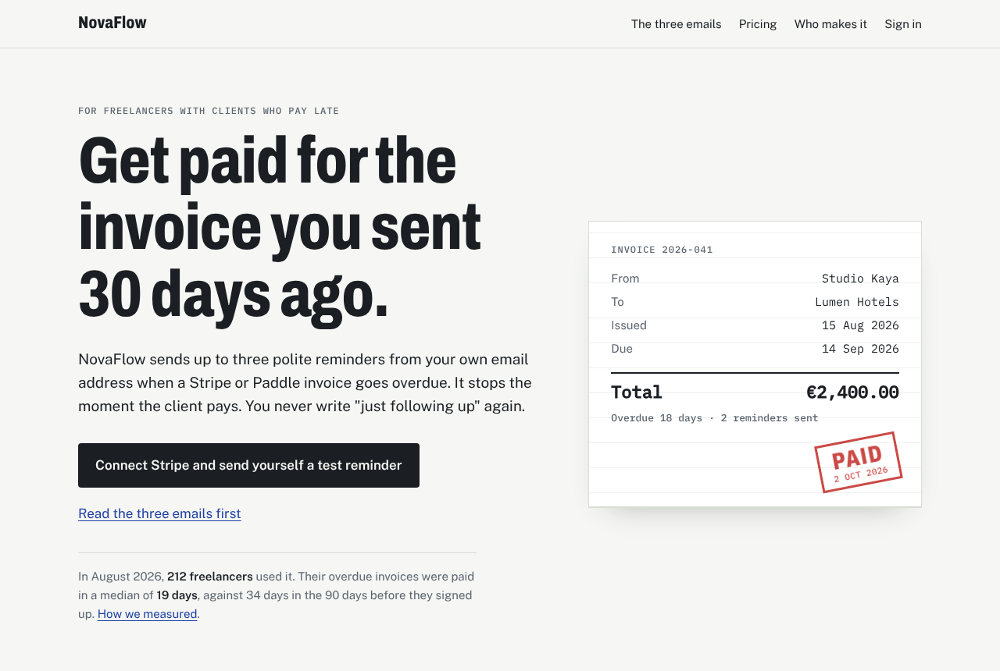
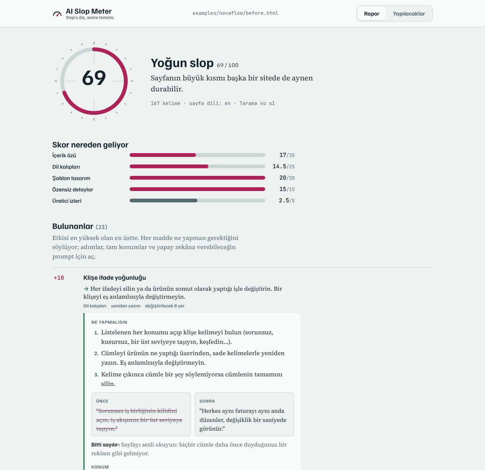
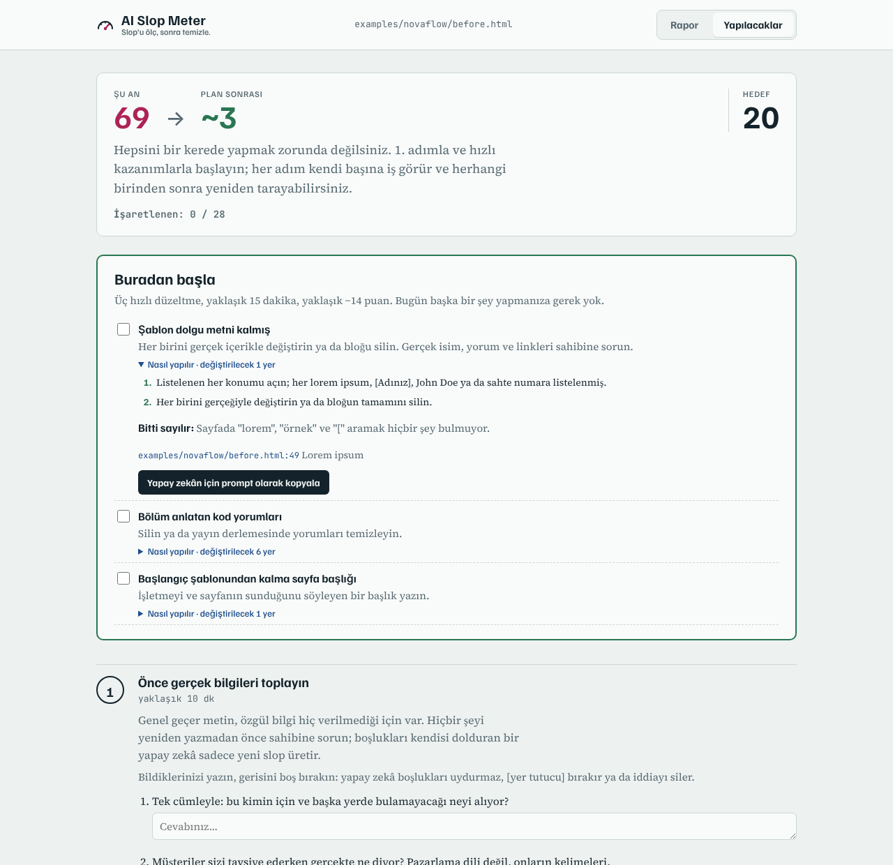
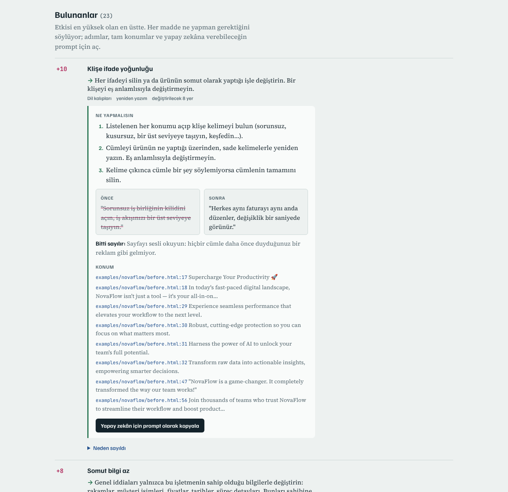

# AI Slop Meter

**Bir sitedeki AI slop'u ölç. Sonra temizle.**

AI Slop Meter bir web sitesini ya da web projesini *slop* açısından puanlar: genel geçer metin, AI site araçlarının varsayılan görünümü ve özensiz detaylar.

- Her puanın kanıtını dosya ve satırına kadar gösterir.
- Sonucu sakin, adım adım ilerleyen bir plana çevirir.
- Sonra bu planı kendi yapay zekân (Claude, Cursor, Gemini CLI ve diğerleri) kodunda uygulayabilir.

Kendi bilgisayarında **MCP sunucusu** ve **komut satırı aracı** olarak çalışır. API anahtarı ya da hesap gerekmez. Taramasını istediğin siteye yapılan istek dışında hiçbir yere veri gönderilmez.

[English README](README.md)

| Önce: 69 / 100, yoğun slop | Sonra: 1 / 100, temiz |
|---|---|
|  |  |

İki sayfa da [`examples/novaflow`](examples/novaflow) klasöründe. "Sonra" sayfası, kurtarma planının sorularına sahibin verdiği cevaplarla yeniden yazıldı ([FACTS.md](examples/novaflow/FACTS.md)). Ürün ve rakamlar kurgudur.

## Ne yapar

1. **Tarar.** Bir URL'yi, bir proje klasörünü (Next.js, Vite/React, Astro, Vue, Svelte, düz HTML, Markdown içerik…) ya da tek bir `.html` dosyasını tarar.
2. **Puanlar.** Araştırmaya dayalı kontrollerle beş alana puan verir ([kriterler ve kaynaklar](docs/CRITERIA.md)):
   - **İçerik özü:** somut bilgi, doğrulanabilir iddia, gerçek kanıt
   - **Dil kalıpları:** klişeler, "sadece X değil, Y", içi boş önem iddiaları
   - **Şablon tasarım:** mor gradyan, parlama ve cam efekti, emoji ikonlar, birbirinin aynı kartlar
   - **Özensiz detaylar:** lorem ipsum, `href="#"`, "Vite + React + TS", sohbet botu kalıntıları
   - **Üretici izleri:** Lovable, Bolt, v0, Replit, Base44 (yalnızca bilgi)
3. **Kurtarma planı çıkarır.** Plandaki her adımın tahmini süresi ve skora etkisi yazar:
   - sahibine sorular (yapay zekâ hiçbir zaman bilgi uydurmasın diye)
   - hızlı temizlikler
   - metin yeniden yazımı
   - tasarım yönü
   - güven düzeltmeleri
4. **Her bulgu için ne yapacağını söyler**, sadece neyin yanlış olduğunu değil:
   - başlığın hemen altında tek satırlık düzeltme;
   - numaralı adımlar ve değiştirilecek tam `dosya:satır` konumları;
   - metin sorunları için önce/sonra örneği ve "bitti sayılır" kontrolü;
   - o tek sorunu Claude, Cursor ya da Lovable'a veren **Yapay zekân için prompt olarak kopyala** düğmesi.
5. **Gösterir.** Sonucu iki ekranlı görsel bir raporda sunar:
   - **Rapor** ekranında skor ve kanıtlı bulgular yer alır.
   - **Yapılacaklar** ekranı üç hızlı kazanımla başlayan bir kontrol listesi ve sorulara cevap yazılacak alanlar içerir.
6. **Yeniden ölçer.** Her değişiklikten sonra önce/sonra tablosu verir.

| Rapor | Yapılacaklar |
|---|---|
|  |  |

Her bulgu aynı "ne yapmalısın" kutusuyla açılır:



## MCP sunucusu olarak kurulum

Node.js 20 ya da üstü gerekir.

**Claude Code**
```bash
claude mcp add aislopmeter -- npx -y aislopmeter mcp
```

**Claude Desktop**: `claude_desktop_config.json` dosyasına ekle:
```json
{
  "mcpServers": {
    "aislopmeter": { "command": "npx", "args": ["-y", "aislopmeter", "mcp"] }
  }
}
```

**Cursor** (`.cursor/mcp.json`), **Gemini CLI** (`~/.gemini/settings.json`), **Windsurf** ve diğerleri: aynı `mcpServers` bloğunu kullan.
**VS Code** (`.vscode/mcp.json`): `"servers": { "aislopmeter": { "type": "stdio", "command": "npx", "args": ["-y", "aislopmeter", "mcp"] } }`.

## Kullanım

Yapay zekâna söylemen yeterli:

> Projemi AI slop açısından tara ve neyi düzeltmem gerektiğini göster.
> https://sitem.com adresini slop'tan kurtar, bitince raporu tarayıcımda aç.

**`rescue` prompt'u** tüm döngüyü çalıştırır. Claude Code'da adı `/mcp__aislopmeter__rescue`. Yapay zekâ sırasıyla:

1. Bitince raporu tarayıcında açıp açmayacağını bir kere sorar. Böylece bilgisayarın başından kalkabilirsin.
2. Hedefi tarar ve en önemli üç bulguyu özetler.
3. Planı çıkarır ve sahibine sorulacak soruları tek mesajda sorar.
4. Planı aşama aşama uygular. Projede tam `dosya:satır` konumlarını düzenler. Canlı bir URL için yeniden yazılmış metni, bir tasarım tarifini ve site aracına yapıştırılacak bir prompt'u verir.
5. Her aşamadan sonra hedef skora (varsayılan 20) inene kadar yeniden tarar.
6. Görsel raporu yazar, izin verdiysen açar ve önce/sonra özetini verir.

Küçük adımlarla ilerlemek istersen **`fix` prompt'u** (`/mcp__aislopmeter__fix`) sadece en önemli sorunu düzeltir, yeniden tarar, neyin değiştiğini gösterir ve sıradakini önerir.

### Araçlar

| Araç | Ne yapar |
|---|---|
| `slop_scan` | URL (`pages` ile iç linkleri de tarar), klasör ya da `.html` dosyası tarar. Görsel raporu yazar, `open_report` ile açar. Aynı hedef yeniden tarandığında otomatik karşılaştırır. |
| `slop_scan_html` | Yapıştırılmış ya da üretilmiş HTML'i tarar. |
| `slop_rescue_plan` | Taramayı aşamalı plana çevirir. `keep` ile sahibinin dokunulmasını istemediği şeyler, `target_score` ile hedef skor verilir. |
| `slop_fix` | Tek bir bulgu için adım adım talimat verir: neyin değişeceği, nerede (`dosya:satır`), örnek ve bitti sayılır kontrolü. `finding_id` verilmezse en önemlisini seçer ve diğerlerini listeler. |
| `slop_report` | Bir taramanın görsel raporunu yazar ya da açar. |
| `slop_compare` | İki tarama arasında önce/sonra karşılaştırması yapar. |
| `slop_guide` | Rehberleri getirir: `criteria`, `playbook`, `copy`, `design`, `interview`. |

## Komut satırı

```bash
npx aislopmeter https://ornek.com --pages 5        # canlı site, en fazla 5 sayfa
npx aislopmeter ./projem --plan --lang tr          # proje klasörü ve Türkçe kurtarma planı
npx aislopmeter ./projem --open                    # görsel raporu yaz ve aç
npx aislopmeter ./dist/index.html --fail-above 40  # skor 40'ı geçerse CI'ı durdur
```

Raporlar `~/.aislopmeter/reports/` klasörüne yazılır. Değiştirmek için `AISLOPMETER_REPORT_DIR` ayarını kullan.

Klasör taramasında `node_modules`, gizli klasörler ve `components/ui` içindeki hazır bileşenler atlanır. Taranan klasörün en üst seviyesindeki `dist`, `build`, `out`, `test`, `docs`, `examples` klasörleri ile README, CHANGELOG, LICENSE gibi depo belgeleri de atlanır. Bunlardan birini taramak için doğrudan o klasörü ya da dosyayı göster. Başka bir yolu dışarıda bırakmak için `--ignore yol1,yol2` kullan.

## JavaScript ile oluşan sayfalar

Sunucu boş bir JavaScript kabuğu gönderirse AI Slop Meter sayfayı **bilgisayarında zaten kurulu olan Chrome ya da Edge** ile render eder. Bunu `playwright-core` üzerinden yapar ve tarayıcı indirmez. Tarayıcı bulunamazsa `AISLOPMETER_CHROME` ile yolunu göster ya da proje klasörünü tara.

## Skor nasıl hesaplanır

Her bulgu puan ekler ve her kategorinin bir tavanı vardır:

| Kategori | Tavan |
|---|---|
| İçerik özü | 35 |
| Dil | 25 |
| Tasarım | 20 |
| Özensiz detaylar | 15 |
| Üretici izleri | 5 |

Gerçek bir işletmenin varlığını gösteren işaretler skoru düşürür: adres, isimli kişiler, fiyat, yasal bilgi, bağımsız yorum linkleri.

Yüksek skor için en az üç alanda sorun olmalı. Tek bir alan ne kadar yüksek olursa olsun (örneğin mor bir marka rengi), skor 45 ile sınırlanır.

Bantlar:

| Skor | Bant |
|---|---|
| 0–19 | temiz |
| 20–39 | iz miktarda |
| 40–59 | belirgin |
| 60–79 | yoğun |
| 80–100 | saf slop |

Neden yapay zekâ hakem değil de kurallar? Bu konudaki en kapsamlı çalışmada "bu slop mu?" diye sorulan dil modellerinin insan editörlerle uyumu κ ≈ 0 çıktı. İnsan yargısını en iyi bilgi yoğunluğu ve alakalılık açıklıyordu. Bu yüzden AI Slop Meter açıklanabilir kurallarla ölçer, senin yapay zekânı yalnızca düzeltmek için kullanır.

## Ne değildir

- **AI ile yazıldığını tespit eden bir araç değildir.** Tamamen AI ile yapılmış bir sayfa temiz çıkabilir, elle yazılmış bir sayfa yüksek skor alabilir.
- **Türkçe listeler henüz ölçülmedi.** Türkçe kaynaklardan ve İngilizce işaretlerin karşılıklarından derlendi. Kalibrasyon katkısı memnuniyetle karşılanır.

## Gizlilik

Her şey yerelde çalışır.
- **URL taraması:** yalnızca gösterdiğin sayfaları çeker.
- **Klasör taraması:** dosyaları yalnızca okur, hiçbirini değiştirmez.
- **Raporlar:** yalnızca senin bilgisayarına, `~/.aislopmeter/reports/` klasörüne yazılır.
- **Telemetri yok.**

## Lisans

MIT
