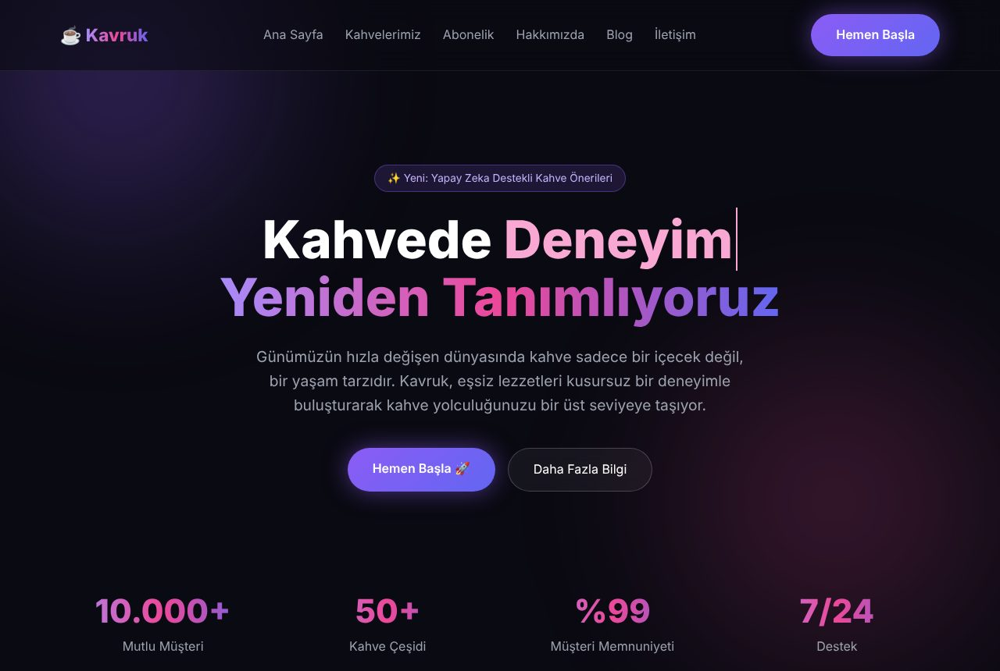
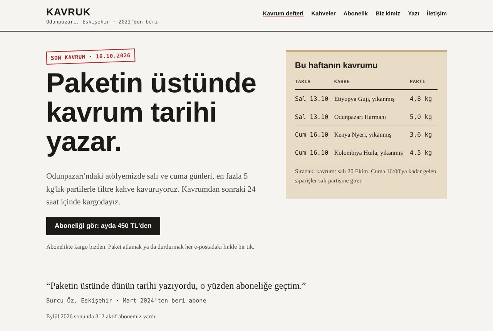

# Kavruk: çok sayfalı bir sitenin kurtarılması

> **Kurgu.** Kavruk, kişileri, adresi ve rakamları bu örnek için uyduruldu.

Altı sayfalı bir kahve kavurma atölyesi sitesi. Önce bir AI site aracının tek prompt'la üreteceği haliyle yazıldı (`before/`), sonra AI Slop Meter'ın planıyla kurtarıldı (`after/`). İki klasör yan yana duruyor; karşılaştırmak için ikisini de açabilirsin.

| | Önce | Sonra |
|---|---|---|
| **Site skoru** | **74** · yoğun slop | **0** · temiz |
| `/` ana sayfa | 80 | 0 |
| `/hakkimizda.html` | 71 | 0 |
| `/blog.html` | 66 | 0 |
| `/kahveler.html` | 60 | 0 |
| `/abonelik.html` | 47 | 0 |
| `/iletisim.html` | 45 | 0 |
| İçerik özü / Dil / Tasarım / Özensiz detay | 12.9 / 15.4 / 28 / 10.8 | 0 / 0 / 0 / 0 |
| **AI arama hazırlığı** (ayrı puan) | **36** · 4/11 | **100** · 11/11 |

Ölçüm 0.3.0 ile, Chromium'da, 17 Ekim 2026'da yapıldı.




## Ne yapıldı, hangi sırayla

1. **Tarama.** `before/` klasörü yerelde açıldı ve site olarak tarandı. AI Slop Meter altı sayfayı buldu, her birine puan verdi ve 34 bulgu çıkardı. Tam rapor ve plan: [once-rapor.md](once-rapor.md), görsel rapor: [rapor/once.html](rapor/once.html).
2. **Sorular.** Planın ilk aşaması sahibine 17 soru soruyor: kimin için, gerçek rakamlar, kim yapıyor, fiyatlar, hangi butonun nereye gideceği… Cevaplar [FACTS.md](FACTS.md) dosyasında. Yeniden yazarken eksik kalan ayrıntılar ikinci bir mesajla soruldu; onlar da aynı dosyada.
3. **Temizlik.** Lorem ipsum, John Doe ekibi, `₺XXX` fiyatlar, `[Adres buraya gelecek]`, `href="#"` linkler, stok avatarlı yorumlar, `/vite.svg` ikonu, bölüm yorumları kaldırıldı.
4. **Metin.** "Bir üst seviyeye taşıyın", "günümüzün hızla değişen dünyasında", "sadece bir içecek değil" gibi her cümle ya sahibinin verdiği bir bilgiyle değiştirildi ya da silindi. 10.000+ / %99 / 7/24 gibi kaynaksız rakamların yerine 312 abone ve "kavrumdan kargoya 24 saat" geldi.
5. **Tasarım.** Mor gradyan, cam efekti, parlayan butonlar, emoji ikonlar, daktilo efekti, birbirinin aynı kartlar ve varsayılan karanlık tema bırakıldı. Palet ürünün kendisinden: kraft kâğıt paket ve kavrum tarihi damgasının kırmızısı. Kahveler kart değil tablo; ana sayfanın ilk ekranında "bu haftanın kavrumu" defteri var.
6. **Güven.** İki kişilik ekip isim ve rolleriyle, atölye adresi, açık olduğu saatler, e-posta, şirket unvanı, tarihli ve imzalı bir blog yazısı.
7. **AI arama.** Her sayfaya JSON-LD (kahveci için `CafeOrCoffeeShop`, yazı için `BlogPosting`) ve canonical adres; sitenin köküne `robots.txt`, `sitemap.xml` ve sitenin kısa özetini veren `llms.txt`. Tasarım kararları da [after/DESIGN.md](after/DESIGN.md) dosyasına yazıldı; sonraki her düzenleme bu dosyaya göre ölçülüyor.
8. **Tekrar ölçüm.** Site 0'a indi: [sonra-rapor.md](sonra-rapor.md), [rapor/sonra.html](rapor/sonra.html).

`after/` sayfalarındaki her bilgi FACTS.md'den geliyor; yapay zekâ hiçbir rakam, isim ya da yorum uydurmadı. Gerçek bir kurtarmada bu fark en önemli kısım: bilgi yoksa metin düzelmez.

## Kendin dene

Her klasörü ayrı bir portta aç ve tara:

```
npx -y serve examples/kavruk/before -l 5801
npx -y aislopmeter localhost:5801 --lang tr --plan --open
```
```
npx -y serve examples/kavruk/after -l 5802
npx -y aislopmeter localhost:5802 --lang tr --open
```

`serve` yerine `python -m http.server 5801` de olur. Klasörü doğrudan taramak da çalışır (`npx -y aislopmeter examples/kavruk/before`), ama o zaman altı sayfa tek proje olarak puanlanır; sayfa sayfa puan için yerelde açıp adresini tara.

Yapay zekânla denemek istersen `before/` klasörünü bir yere kopyala ve şunu söyle: "Bu klasörü localhost'ta aç, AI slop açısından tara ve kurtar. Soruları bana sor." Cevap olarak FACTS.md'deki bilgileri verebilirsin.
